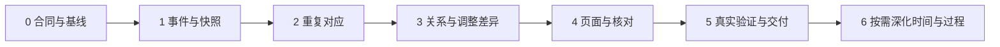

# AI 复盘：同线路细粒度动作对比实施计划

> 2026-10-03 优先级更新：先按[动作样本驱动识别与知识库建设方案](AI复盘_动作样本驱动识别与知识库_建设方案_2026-10-03.md)建设样本、动作类别及新视频识别。本文阶段保留为后续比较功能计划，不再表示当前开发顺序；下文状态记录对应原编制日期。

日期：2026-10-01。版本：v1.0。配套需求：[完整 PRD](AI复盘_同线路细粒度动作对比_PRD_2026-10-01.md)。状态：计划已编制，下面六个开发阶段均未开始；文档完成不等于功能完成。

## 1. 执行原则

单人按阶段串行推进，复用现有事件与播放器，优先把比较逻辑做正确。每阶段有独立交付物与退出条件，前一阶段不满足条件时修复或按文中的降级路径调整，不带着不明误差进入下一阶段。

所有源码基于 `D:\ai_climbing_code\worktrees\ai_climbing_code_v4-photo-yellow-release` 的最新提交。编码前读取 AGENTS 与 LOCAL_LATEST、检查工作区，保护其他进行中的改动。真实素材与账号数据不提交，`.local/` 不删除、覆盖、输出或上传。

本次用户授权交付 PRD 与计划，未在本轮实施程序或生产部署。后续编码按明确的阶段任务执行；部署始终另有用户明确任务。

## 2. 六阶段总览

| 阶段 | 目标 | 主要交付物 | 预计集中工作量 | 进入下一阶段的条件 |
| --- | --- | --- | --- | --- |
| 0：冻结范围与证据合同 | 明确已有数据能支持什么 | 快照/边界合同、样例与评价清单、当前基线 | 2–3 人日 | 不再把缺失细节当作已有事实 |
| 1：事件适配与只读快照 | 把细节完整送入比较 | 事件适配模块、版本摘要、资格检查 | 4–6 人日 | 同点事件不丢失；版本/账号/媒体状态正确 |
| 2：重复事件对应 | 找准同一动作出现次数 | 分肢体对齐、歧义与未匹配输出、对照工具 | 5–8 人日 | 反例通过；跨肢体顺序变化没有被匹配规则消掉 |
| 3：细节差异计算 | 比较关系与同点调整 | 三类关系、调整窗口与差异卡片数据 | 4–7 人日 | 边界与遮挡保护通过；事实和对应确认区分 |
| 4：页面与局部核对 | 用户可以实际操作 | 新接口、页面组件、证据回看、会话确认 | 5–8 人日 | 完整流程可用，已有复盘行为不回归 |
| 5：真实先导与交付 | 证明收益及实际限制 | 冻结对照报告、失败案例、交付说明与演示 | 4–6 人日 | 结果如实分层，验收条件满足或明确降级 |

合计暂估 **24–38 个集中工作人日**，只是排期起点，不是交付承诺；不含获取素材、独立审核者排期、等待反馈和生产部署。阶段 0 根据实际事件完整度修正估算。若每周投入约 3 个完整工作日，可粗排为约 8–13 周；实际投入未知，暂不承诺日历日期。

P1 时间分布与往返过程在首版完成后另设阶段 6，按证据与收益选做，不进入上面的首版总量。

依赖：

阶段 2 后可获得可运行的算法原型，阶段 4 后可获得可操作的本地首版；这两个节点都不代表真实识别质量或生产发布已经通过。

## 3. 阶段 0：冻结范围、输入与评价

### 输入

PRD、研究方案、当前 `replay_segments / replay_actions / replay_action_naming / replay_action_trajectory / replay_action_jobs`，既有词典、独立验收说明和版本化修正流程。

### 工作项

- T0-01：只读检查当前提交与工作区；列出本阶段不应覆盖的其他改动。
- T0-02：梳理有效 `action_result`、只读 `organize()` 派生、基础分段、人工修正各类来源及优先级。
- T0-03：冻结事件、合法岩点映射、时间边界、可见窗口、未知原因与来源合同。不能把原片 30 FPS 当作分析也有 30 FPS。
- T0-04：冻结三项 P0、接口字段、性能支持量和首批反例。P0 不加入新模型、全片加密或比较视频导出。
- T0-05：建立基线与评价清单。当前方法、普通序列对齐、候选方法使用相同固定输入。
- T0-06：登记真实材料是否获准、是否已经用于调参、原片与审核条件是否满足。材料不足时先开展构造输入研究。

### 交付物

输入/输出合同、字段来源矩阵、版本摘要定义、测试用例清单和基线结果结构。可存放于 `docs/replay-fine-comparison/`；构造输入放入测试素材目录，真实原片和私人标注仅保留获准的本地评估位置。

### 验收与退出条件

原始时间坐标、快照有效性与岩点映射有明确依据；只读派生无虚构可写版本；每项细节有缺失时的退化规则。阶段工作量和事件上限重新确认后冻结。

若当前输入无法提供可靠接触：继续实施运动启动/重叠对应研究，接触—启动关系留未知；不扩大采集/训练范围来强行补齐。

## 4. 阶段 1：事件适配与只读快照

### 工作项

- T1-01：新增独立纯适配模块，建议 `backend/core/replay_fine_inputs.py`；不把复杂逻辑继续塞进大页面或旧分段函数。
- T1-02：读取版本有效的细化动作优先；无有效已保存动作时使用可验证的只读派生。失效旧结果不能优先于有效当前派生。
- T1-03：保留同点调整和重复真实事件，去掉同一证据事实的重复引用。
- T1-04：将视频内岩点 ID 映射到确认线路对象；未知身份不作为强锚点。
- T1-05：构建运动/接触边界范围、证据窗口和缺口。不在不可见时段延续接触，不借插值补真实事实。
- T1-06：生成确定性 `comparison_input_version`，覆盖基础结果、有效动作、修正、线路、授权/媒体状态、适配版本等相关输入。
- T1-07：实现同账号、同路线版本、两条完成记录、同人/机位确认的资格检查；快照读取与计算后复核的并发合同。

### 交付物

适配模块、构造快照、可用维度/未知原因输出。新增针对性的输入与版本测试，建议 `backend/test_replay_fine_inputs.py`。

### 验收

覆盖 PRD FR-01/02/03/12/14 的后端部分：同点调整不消失，非法身份不对应；修正/撤销/重算和删片等变化使输入摘要失效；相同输入摘要相同；只读操作不改变原分析与历史。

无有效保存动作但可派生时可计算支持的维度；原片缺失时只给兼容浏览与缺口，不提供新事实确认。新适配层失败不得使旧比较失效。

## 5. 阶段 2：分肢体序列对应

### 工作项

- T2-01：新增 `backend/core/replay_fine_alignment.py` 候选模块，输入为阶段 1 快照，不直接调用云模型或修改任务。
- T2-02：分别按四肢构建序列，保留肢体内部顺序、同点调整及返回/再次到达的上下文。
- T2-03：建立身份/事件类别/前后文匹配规则。明确身份冲突、未知与未匹配的代价；持续时间不能主导配对。
- T2-04：采用允许跳过事件的一对一序列匹配，输出多出、缺失、未知；不能把插入调整融合进相邻动作。
- T2-05：为等价候选保留歧义，不通过字典遍历顺序或随机规则制造唯一对应。
- T2-06：提供有限会话配对覆盖的校验逻辑：合法版本、同肢体、一对一、非交叉，可标记不对应。
- T2-07：加入现有起终点匹配与普通序列匹配基线，编写统一比较输出工具。配置、输入摘要、算法版本与结果绑定。

### 交付物

对应模块、候选/未匹配合同、命令行或脚本评价入口、构造配对真值与算法测试。建议测试文件 `backend/test_replay_fine_alignment.py`。

### 验收

覆盖 FR-04/05/11 的逻辑：重复 A→B 不随便取首个；同点真实事件保留；跨肢体先后改变不导致同义事件失配；手脚事件不跨肢体配对；不能用人工覆盖后的成绩冒充自动配对成绩。

构造用例至少覆盖第 9 节 A 类清单。真实先导上配对没有改善时，保留最简单的有效方案，记录失败原因；不立即转向深度学习。

## 6. 阶段 3：手脚关系与同点调整差异

### 工作项

- T3-01：新增 `backend/core/replay_fine_relations.py` 候选模块，独立计算启动先后、接触—启动先后和重叠，保留每类证据资格。
- T3-02：按边界范围判断顺序，计算重叠上下界；明确门槛及来源，边界模糊退未知。
- T3-03：以两次可靠共同锚点构造对应窗口，比较同肢体/同点/同定义的调整。不同可见覆盖不作精确数量差。
- T3-04：新增差异组织模块候选 `replay_fine_comparison.py`：匹配、关系、调整差异、未知与覆盖分开输出。
- T3-05：短句通过受约束模板生成；不新增大模型解释调用，不生成因果和专业评分。
- T3-06：附两次证据引用、来源、事件与输入版本；不返回私密路径。

### 交付物

三类关系计算、调整窗口、差异输出与针对性测试，建议 `backend/test_replay_fine_relations.py`。

### 验收

覆盖 FR-06/07/08/09/14：脚先启动与重叠可共存；腕踝靠近不能确认脚点接触；一侧遮挡不能宣称少一次调整；不同来源不会合并成专业确认；数值精度不超过证据精度。

B 类反例全部通过，已有合法事实不被比较层改写。关系无法计算时，仍能返回已有可靠配对及其他维度结果。

## 7. 阶段 4：接口、页面与局部核对

### 工作项

- T4-01：在现有账号隔离 API 体系内接入新预检/计算接口，不修改旧 `/comparisons` 返回值。
- T4-02：读取一致快照并在返回前复核版本；失效返回具体状态；限额检查不静默截断。
- T4-03：`climbReplayService.js` 增加新请求与取消/竞争保护。页内状态绑定记录对与快照版本，旧请求不能覆盖新选择。
- T4-04：页面内独立组件候选 `ReplayFineComparisonPanel.vue`，差异卡片候选 `ReplayFineDifferenceCard.vue`；只对必要入口修改 `ClimbReplayPage.vue`。
- T4-05：加入记录选择、同人/机位确认、覆盖摘要、差异/候选/未知列表。证据区只展开当前卡片。
- T4-06：两次原片独立定位回看，复用已有裁剪偏移与源时间适配，0.75 倍播放；不重复减速、不默认双视频时间拉伸同步。
- T4-07：歧义配对通过会话覆盖重新计算；原动作修改复用现有 review/undo。明确会话刷新后不保留配对确认。
- T4-08：动作修正、返回前台、回看前预检输入版本；失效后暂停旧结论。切记录、退出登录清空所有比较私密状态。
- T4-09：加载、空态、原片缺失、撤回授权、网络失败、超限、记录删除、无可比事件提供可恢复文案。

### 交付物

新接口、前端服务与组件、接口/前端状态测试及浏览器用例。建议新增 `backend/test_replay_fine_api.py`、`frontend/test/replay-fine-comparison.test.mjs`、`frontend/browser-tests/replay-fine-comparison.test.mjs`。

### 验收

覆盖 FR-01/02/10/11/12/13/14：一次完整选择—计算—回看—确认—修正—失效—重算流程可运行；原片缺失不误用派生视频确认；旧记录可退基础比较；浏览器刷新后的会话行为与提示一致。

手机/桌面和键盘检查通过；统一复盘播放器、骨架/岩点、动作图、动作顺序、0.75 时钟、结束总结与圆盘重开、既有修正/撤销和导出无相关回归。

纯比较请求和进入页面均无新增云分析调用；可通过调用桩/日志元信息核验，不读取密钥或真实媒体内容输出。

## 8. 阶段 5：真实先导、对照与交付

### 工作项

- T5-01：冻结实现、配置、源码版本、评价规则、材料清单与标注版本。开发材料与独立评价分组隔离。
- T5-02：先跑固定人工事件输入，评价比较方法；再跑真实原片全链，分别记录识别与比较错误。
- T5-03：对照现有方法、普通序列匹配和候选方法。对上下文、关系处理和边界机制分别做移除对照；验证每个复杂部分的必要性。
- T5-04：在相同精度或相同覆盖等可比条件下看收益，同时报告完整曲线/未知比例，不能靠大量拒绝提高精度后隐藏覆盖。
- T5-05：先导回看任务记录定位与修正耗时，轮换使用顺序或单列熟悉度影响；视频播放长度/信息条件一致。
- T5-06：在阶段 0 指定本机测量比较增量时间、内存与上限；不把原模型识别耗时混入轻量比较指标。
- T5-07：整理失败案例、适用场景、缺失材料、回退操作和正式验收剩余事项。
- T5-08：完成参赛可用演示：两次记录、一个顺序变化、一个重复/调整差异和一个未知案例。真实/预计算/构造素材明确标识。

### 交付物

算法对照报告、端到端先导报告、使用任务记录、资源测量、案例卡、演示录屏和本地交付说明。真实媒体仅在获准位置保存；公共报告匿名并核对展示权限。

### 验收与准入区分

本地辅助工具：P0 硬条件通过，自动候选与人工来源清楚，未知保护和回退可靠；有不足的真实先导结论完整披露。

算法研究：同一固定输入下，候选方法配对精度不降低，且重复错配/正确覆盖/核对负担至少一项有实测收益；否则交付较简单方法和真实研究结论。

正式视频识别质量：仍需现有两名审核者、独立留出、类别样本与正式门禁，不能用单人先导或构造用例替代。无法满足时标“未通过”，不暂停可以完成的本地算法/工具交付，也不放开专业标签。

生产上线：此计划不自动执行。用户后续明确部署时，按 README 的 PR/main/不可变标签/release-gate/发布脚本流程执行，并完成线上核验。

## 9. 验收用例清单

### A. 对应关系

| 编号 | 输入/情况 | 预期 |
| --- | --- | --- |
| A01 | 相同事件序列、速度不同 | 对应保持一致，不以录像绝对时刻配对 |
| A02 | 重复 A→B→A→B | 利用上下文或保留歧义，不随便取首个 |
| A03 | 一侧插入同点调整 | 调整作为独立事件/差异保留 |
| A04 | 两侧重复次数不同 | 无对应项明确输出，不强制多对一 |
| A05 | 四肢总体顺序改变 | 各肢体正确对应，随后检测关系变化 |
| A06 | 同名点 ID 实际不是同线路对象 | 不匹配；合法身份映射优先 |
| A07 | 用户覆盖造成一对多/交叉 | 拒绝；覆盖撤销不修改原分析 |
| A08 | 多条等价对应路径 | 返回歧义与有限候选 |

### B. 细节与证据

| 编号 | 输入/情况 | 预期 |
| --- | --- | --- |
| B01 | 脚先启动，手脚区间重叠 | 两种关系并存 |
| B02 | 脚先动但接触晚于手启动 | 不写“脚接触后才伸手” |
| B03 | 启动差小于边界范围 | 先后未知，不自动称同步 |
| B04 | 脚部遮挡/配准缺口 | 接触关系与精确计数退未知 |
| B05 | 踝点进入岩点框但无原片事实 | 不能确认接触 |
| B06 | 一侧完整两次调整，一侧不完整只见一次 | 不能宣称减少一次 |
| B07 | 无新接触但身体仍移动 | 不计为全身停顿 |
| B08 | 末端趋稳但未确认接触 | 只描述位置趋稳 |
| B09 | 原点调整 vs 离点再接回 | 按不同事实保留，不互相替代 |
| B10 | 姿态突跳/左右链交换 | 不生成真实往返或新增调整 |
| B11 | 点估计有重叠，但边界范围仅支持可能重叠 | 重叠未知，不显示确定同步 |

### C. 页面、生命周期与权限

| 编号 | 输入/情况 | 预期 |
| --- | --- | --- |
| C01 | 跨账号请求 | 无访问、无存在信息泄漏 |
| C02 | 同记录/不同路线版本/未确认同人 | 拒绝并有原因 |
| C03 | 输入在计算中被修正或重算 | 结果失效，不输出过期事实 |
| C04 | 撤销修正 | 新摘要与比较正确，原历史保留 |
| C05 | 原片删除/源记录正在删除/授权撤回 | 按当前生命周期暂停核对或新比较 |
| C06 | 快速切换比较记录，旧请求晚返回 | 不覆盖新状态 |
| C07 | 裁剪片段和 0.75 播放 | 各自原片定位正确，无双重偏移/减速 |
| C08 | 旧记录只有基础分段或只读派生 | 合理退化，不伪造可写动作版本 |
| C09 | 手机/键盘/长列表 | 可完整操作，证据按需展开 |
| C10 | 退出登录、刷新、后台返回 | 私密会话清理/重算说明明确，返回前台预检 |
| C11 | 输入超限 | 明确拒绝，不截断后伪报完整覆盖 |
| C12 | 进入页面与计算比较 | 不触发新增云动作识别或分析费用 |

这些用例是实施后必须验证的场景，当前没有执行或通过结果。

## 10. 评价材料、复核与结果合同

构造材料可提交仓库，明确 `synthetic=true`。真实材料必须登记授权、匿名身份/线路组、原片摘要、开发/留出归属及是否参与调参，不提交原片。

按同人/同线路关联成组，关联材料不跨开发与正式留出。单个人单条线路的多帧/多次尝试不能虚增为大量独立分组。

真实先导可从少量重复尝试启动，单人标注标明 `review_mode=single_reviewer_pilot`；不能为满足工具条件伪填两人审核。正式评价复用现有审核与裁决要求。

每份报告至少绑定：源码/算法/适配版本、参数摘要、输入与标注摘要、模式（构造/人工事件/真实视频）、分组和样本数、来源占比、指标分母、未知比例、失败案例、资源环境及准入状态。

自动对应成绩、用户确认后的成绩、视频自动识别成绩分开报告。研究中用到的人工事件真值不能反过来当作自动识别输出。

## 11. 代码与测试影响地图

以下为候选文件安排；阶段 0 可根据现有模块结构调整，但职责保持分离。

| 层 | 候选新增/修改点 | 保持的边界 |
| --- | --- | --- |
| 输入 | `replay_fine_inputs.py` | 只读；不直接重写 job/源文件 |
| 对齐 | `replay_fine_alignment.py` | 纯算法；不调用云 API |
| 关系 | `replay_fine_relations.py` | 不升级专业标签或真实受力结论 |
| 组合/API | `replay_fine_comparison.py` 与现有 router 接入 | 旧 `/comparisons` 合同保持 |
| 前端服务 | `climbReplayService.js` | 新方法与版本/竞争处理独立 |
| 页面 | 新面板/卡片、现有页面入口 | 不替换统一播放器、骨架或动作图 |
| 评价 | 独立比较评测入口 | 不改现有自动准入状态 |

新增针对性测试核验算法失配、证据保护、账号/版本和时钟，避免只验证实现字段是否存在。

每阶段运行相关后端/前端测试；阶段 4 跑新浏览器流程及现有复盘相关浏览器检查；阶段 5 执行后端发布测试入口、前端测试、发布浏览器集合和生产构建。具体命令以届时仓库 README、脚本和 package.json 为准，检查条件跳过项，不能把跳过模型测试算成通过模型运行时。

文档编制本轮只检查文件、链接和需求映射，不运行或声称软件验收。

## 12. 阶段 6：首版后的细节深化（可选）

### 6A. 对应窗口的时间分布

输入必须是已验收的事件对应和有效时段。实现可见静止/运动/接触后调整/未知的区间并集，运动重叠不重复累加，总量覆盖对应窗口。

验收 FR-15：部分分类缺失时未知保留；耗时缩短不判专业进步；媒体速率不影响原片统计。无法支撑全量分项时只展示可信分项与未知。

### 6B. 往返与相对身体过程

复用当前轨迹算法，原片核对往返，排除抖动、链交换、躯干共同运动。轨迹往返与接触后的再抓/再踩分别建立事实。

验收 FR-16：低帧率/遮挡不强判；完整连续事件才能比较过程；新字段真实收益不足时保留在研究分支，不进入默认界面。

6A/6B 分别估算与排期，不提前启动全片加密、专业技巧分类或大模型训练。

## 13. 回退与风险处置

- 算法无收益：保留旧/普通匹配，用评价报告解释，缩小新算法范围。
- 证据不足：退未知，不覆盖原事实，不追加未经授权云调用。
- UI 回归：通过功能开关关闭细节比较，原播放器和旧比较继续使用。
- 数据风险：P0 无迁移/批量写入；会话覆盖可直接清除，不操作真实数据目录。
- 并发冲突：编码前重新检查工作区与模块改动，不能覆盖其他窗口正在完成的修正。
- 真实验证延期：算法与本地候选工具可先交付，报告标明正式验证待完成，不伪造样本或准入。

## 14. 阶段交付记录模板

每阶段完成后填写一页记录：

| 项目 | 需要登记 |
| --- | --- |
| 范围 | 本次覆盖的 T/FR 编号及未完成项 |
| 版本 | 源码、算法、合同、参数版本 |
| 交付物 | 实际模块/报告/界面与位置 |
| 验证 | 运行检查、结果、跳过项和材料模式 |
| 保护 | 原片/历史/其他改动保持情况，新增云调用是否为零 |
| 风险 | 未知、失败、阻塞及降级决定 |
| 结论 | 通过/部分通过/未通过，下一阶段输入是否就绪 |

阶段记录使用实际证据填写，不提前写“全部通过”。当前文档交付仅代表 PRD 和计划已完成。

## 15. 需求—任务—验证映射

| PRD 需求 | 主任务 | 验证用例/位置 |
| --- | --- | --- |
| FR-01 资格与隔离 | T1-07、T4-01 | C01、C02 |
| FR-02 一致快照与失效 | T1-06、T4-02、T4-08 | C03、C04、C05、C10 |
| FR-03 身份和同点保留 | T1-03、T1-04 | A03、A06、B09 |
| FR-04 重复对应 | T2-02、T2-03、T2-05 | A02、A08 |
| FR-05 未匹配事件 | T2-04 | A03、A04 |
| FR-06 启动先后 | T3-01、T3-02 | B01、B03 |
| FR-07 接触—启动先后 | T3-01、T3-02 | B02、B04、B05 |
| FR-08 可靠重叠 | T3-01、T3-02 | B01、B11 |
| FR-09 调整差异 | T3-03 | B06、B09 |
| FR-10 原片回看 | T4-06、T4-09 | C05、C07 |
| FR-11 会话配对确认 | T2-06、T4-07 | A07、C10 |
| FR-12 动作修正复用 | T1-02、T4-07 | C04、C08 |
| FR-13 状态与请求竞争 | T4-03、T4-08、T4-09 | C06、C10、C11 |
| FR-14 来源与覆盖 | T3-04、T3-06、T4-05 | B04、B06、C08；阶段 5 来源分表 |
| FR-15 时间分布（P1） | 阶段 6A | 区间覆盖、重叠去重、未知时段和原片时钟专项验收 |
| FR-16 往返过程（P1） | 阶段 6B | B10 与真实连续原片专项验收 |

实施任务完成不自动等于需求通过；对应测试、真实证据及未通过项都须进入阶段交付记录。
