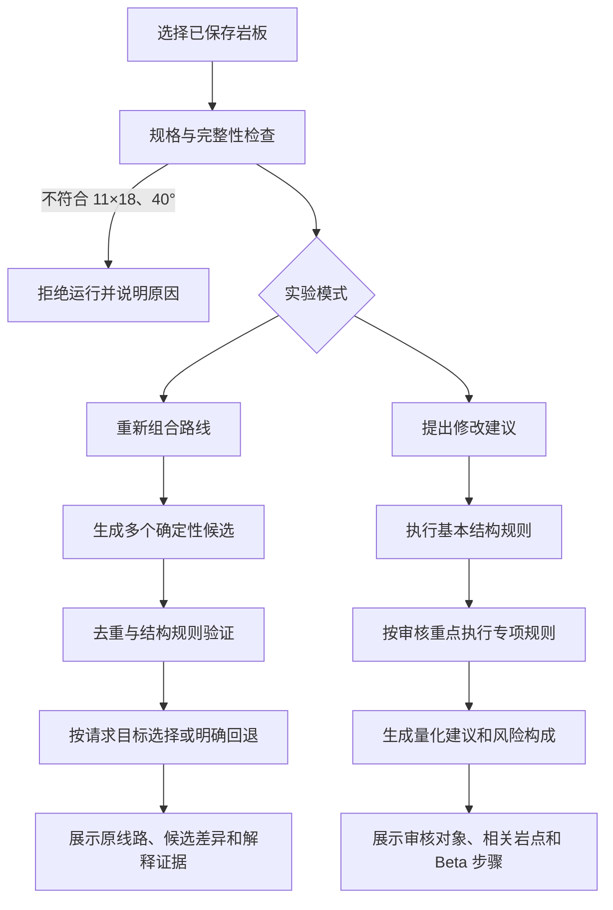

# AI 实验室算法与工作流说明

版本：`ai-lab-rules-v2`

解释结构：`ai-explanation-v2`

适用范围：11×18、40° 岩板，Font 6B 至 8B+

## 1. 功能定位

AI 实验室是定线辅助工具，当前只承诺：

1. 为定线讨论提供结构候选。
2. 快速发现明显的岩点布局、Beta 引用和动作结构问题。
3. 生成不会覆盖原线路的候选草案。
4. 展示可复核的规则、观测值、阈值、评分和候选筛选依据。

AI 实验室不替代定线者的最终判断、真人试爬、安全检查或正式定级。系统显示“通过”时，只代表通过了对应版本的已执行规则；标为“未检查”的项目不参与安全结论。

## 2. 决策边界

系统由三个彼此隔离的部分组成：

| 部分 | 职责 | 能否改变算法结论 |
|---|---|---|
| 本地确定性规则 | 候选生成、结构评分、规则检查、风险计算和排序 | 能 |
| 固定 Font 难度模型 | 根据坐标结构和岩点负荷估算 MoonBoard 等效难度 | 能，只影响难度相关字段 |
| 大模型语言润色 | 润色中文名称和短说明 | 不能 |

大模型不能修改岩点、Beta、评分、风险、难度、检查状态、候选顺序或解释证据。大模型不可用或返回不合规内容时，系统使用本地中文模板。

`optimal_patterns.json` 中的历史优质模式当前是研究参考，不直接参与运行时评分和排序。标准线路平均结构同样只用于结果对照。界面不能把二者描述为“已应用约束”。

## 3. 总体工作流

每次结果包含输入指纹。相同输入、相同规则版本和相同难度模型版本必须得到相同的检查、评分和候选顺序。

## 4. 重新组合路线

### 4.1 候选来源

系统依次尝试：

1. 动作顺序搜索候选。
2. 本地“质量优先”候选。
3. 本地“难度匹配”候选。
4. 本地“风格变化”候选。

本地候选只复用原岩板上的岩点，不移动坐标，也不会直接修改已保存线路。

### 4.2 三种本地策略

#### 质量优先

从中段岩点中按高度、中心距离和岩点负荷排序，再均匀抽取。目标是保持较完整的纵向覆盖、横向展开和结构连续性。

#### 难度匹配

从最多 10 个中段候选点中枚举 3 至 7 个岩点的组合。比较顺序为：

1. 目标难度偏差越小越好。
2. 结构质量越高越好。
3. 内部难度分与目标负荷的距离越小越好。

#### 风格变化

把中段岩点分为左右区域，交替选择并缩减到少量中段点，使候选与原线路形成可见差异。

### 4.3 去重与有效候选

候选必须：

- 与原线路的岩点集合不同；
- 与已保留候选不同；
- 具备手起点、脚点和高位终点；
- 岩点数量在 6 至 14 个之间；
- 最大纵向断档不超过 5 排；
- 横向覆盖至少 3 列；
- 通过基础布局验证。

未通过的候选会保留固定原因代码，例如：

- `duplicate_layout`
- `solver_no_candidate`
- `rule_validation_failed`

### 4.4 请求目标与回退

三个用户目标分别优先展示：

| 用户目标 | 首选策略 |
|---|---|
| 质量优先 | 质量优先 |
| 目标难度优先 | 难度匹配 |
| 动作风格多样 | 风格变化 |

如果首选策略没有产生不同且通过检查的候选，系统按固定顺序展示其他有效草案，并明确标记为“回退候选”。解释中必须列出首选策略失败、重复或未通过的具体原因，不能写成“按首选目标入选”。

### 4.5 重组依据

每个候选返回：

- 请求目标是否命中；
- 是否发生回退；
- 保留、移除和新增的岩点；
- 每个移除决定的原因代码；
- 原线路与候选的结构质量、难度、岩点数量、横向跨度和最大断档；
- 目标难度偏差；
- 原岩点复用率；
- 候选筛选轨迹。

复用率分级：

- 70% 及以上：最优复用；
- 40% 至 69%：通过复用标准；
- 低于 40%：较大改动。

### 4.6 动作草案边界

本地策略生成的 Beta 按起点和岩点高度形成左右手交替的讨论草案。它没有通过完整身体平衡验证，因此：

- 候选只显示“结构风险”；
- 动作风险显示“未评估”；
- 不能把结构风险 0 解释为线路安全；
- 必须由定线者复核动作并试爬。

## 5. 提出修改建议

### 5.1 基本结构规则

所有审核重点都会执行：

- 岩板规格；
- 岩点数量；
- 手起点；
- 脚点支撑；
- 高位终点；
- 纵向连续性；
- 横向展开。

### 5.2 审核重点

| 审核重点 | 额外执行规则 |
|---|---|
| 综合检查 | Beta 引用、身体平衡、连续手部动作、目标难度偏差、脚点支撑建议 |
| 脚点检查 | Beta 引用、身体平衡、脚点数量与支撑 |
| 难度检查 | 目标难度偏差 |
| 动作顺序检查 | Beta 引用、身体平衡、连续手部动作 |

没有执行的专项规则显示“未检查”，不会伪装成通过，也不计入本次风险。

### 5.3 Beta 身体平衡

系统按动作顺序重建左右手和至少一只脚的接触状态，计算：

- 可评估接触状态数量；
- 对侧上方高踩次数；
- 手部中心与脚部中心的平均横向偏移；
- 相关岩点；
- 相关 Beta 步骤。

当前阈值：

- 对侧上方高踩少于 2 次；
- 手脚中轴平均偏移不超过 1.8 列；
- Beta 必须包含明确完攀动作；
- 必须能够重建两手和至少一脚的稳定接触状态。

### 5.4 连续手部动作

系统寻找 Beta 中最长的连续手部动作段。

- 少于 4 次：通过；
- 4 次及以上：建议增加脚步推进或调整手点顺序。

结果会返回连续次数、相关岩点和 Beta 步骤。

### 5.5 量化建议结构

每条建议包含：

- `reason_code`：机器可测试的原因代码；
- `observed`：本次观测值；
- `threshold`：判定阈值；
- `expected_effect`：修改后希望改善的指标；
- `hold_ids`：相关岩点；
- `beta_steps`：相关动作步骤；
- `confidence`：证据可信度；
- `evidence_status`：已量化、模型估算或尚未量化；
- `group`：必须修、建议修或可选优化。

修复候选仍然只是结构草案，不会覆盖原线路，也不能代替对具体问题的真人修改。

## 6. 结构质量分

结构质量分只衡量可计算的布局特征，不等于综合定线质量。

| 分项 | 满分 | 计算逻辑 |
|---|---:|---|
| 岩点数量 | 18 | 8 个得分最高，偏离越多分数越低 |
| 横向展开 | 20 | 3 列开始计分，8 列及以上满分 |
| 纵向覆盖 | 18 | 覆盖 16 排满分 |
| 纵向连续性 | 20 | 最大断档 3 排以内满分，超过后递减 |
| 起点与终点 | 16 | 同时具备明确手起点和高位终点得满分 |
| 脚点支撑 | 8 | 3 个脚点得满分 |

六项之和必须等于最终结构质量分。该分数不包含动作流畅度、具体抓握方向、疲劳、身高差异或真人体感。

## 7. 难度估算

自有线路的难度是 MoonBoard 等效 Font 难度，不是正式定级。模型使用：

- 岩点坐标与角色；
- 岩点类型、旋转和已复核属性；
- 动作距离与负荷特征；
- 固定版本 MoonBoard 数据模型。

结果同时返回：

- 预测 Font 等级；
- 与目标等级的档位偏差；
- 难度可信度；
- 可信度等级；
- 校准状态；
- 难度理由。

使用未人工复核的自有岩点时，可信度不能标为高。

## 8. 风险分

### 8.1 结构风险

结构风险由以下项目组成，最高 100：

- 每个基本结构失败：22 分；
- 最大纵向断档超过 4 排：12 分；
- 脚点少于 2 个：10 分；
- 难度偏差：每档 5 分，上限 20 分。

重组候选只返回结构风险，并明确标记动作风险未评估。

### 8.2 审核专项风险

审核模式按已执行重点增加：

- Beta 引用失效：22 分；
- 身体平衡未通过：20 分；
- 连续手部动作达到 4 次：从 9 分起，随连续次数增加，最高 15 分。

风险等级由建议严重程度决定：

- 存在“必须修”：高；
- 存在“建议修”或规则问题：中；
- 已执行规则均未触发问题：低。

如果关键动作数据缺失，风险评估状态为“部分”，界面显示“风险未完整评估”，不能显示为低风险安全结论。

## 9. 结果解释顺序

结果页按以下顺序展示：

1. 一句话结论和风险评估范围；
2. 必须处理的问题；
3. 结构质量、风险、难度和已执行范围；
4. 原岩板或审核对象；
5. 评分分解与规则清单；
6. 候选筛选轨迹或量化修改建议；
7. 输入指纹、规则版本、难度模型版本和参考说明。

所有状态同时使用文字，不只依赖颜色。

## 10. 已知限制

- 只支持 11×18、40° 岩板。
- 本地重组不会新增或移动坐标。
- 结构质量分不是综合线路质量分。
- 候选 Beta 是讨论草案。
- 身体平衡规则是快速筛查，不能覆盖全部人体工学、动态动作和疲劳。
- 难度是等效估算，需要结合可信度理解。
- 当前没有用真人反馈在线修改运行时规则。
- 定线者仍需复核、试爬并决定是否采用。

## 11. 验收要求

- 同一输入和同一版本产生相同指纹、评分、检查和候选顺序。
- 请求策略不可用时必须显示回退原因。
- 重组候选必须与原线路不同，不能复制候选凑数。
- 候选动作未验证时不能显示为完整低风险。
- 四种审核重点必须执行不同的专项规则。
- 未执行规则必须显示“未检查”。
- 每条修改建议必须包含观测值、阈值和预计改善。
- 风险分解之和必须等于最终风险分。
- 大模型异常时，所有算法结论保持不变。
- 390px 页面不产生页面级横向溢出。
