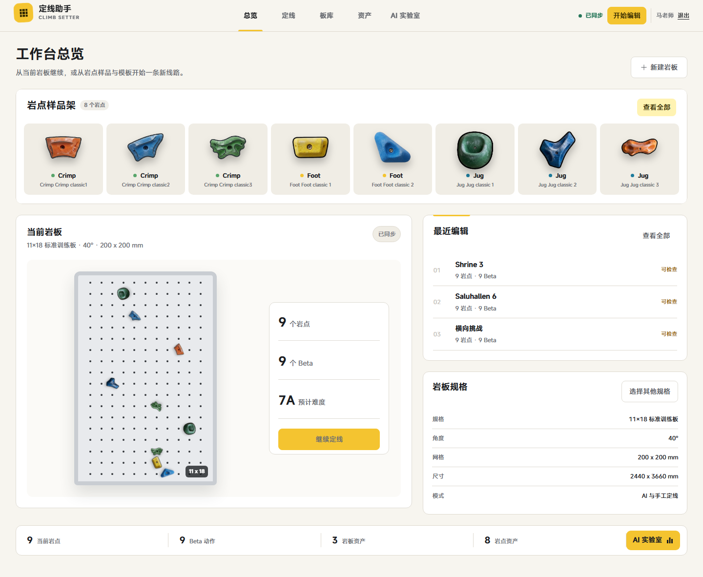
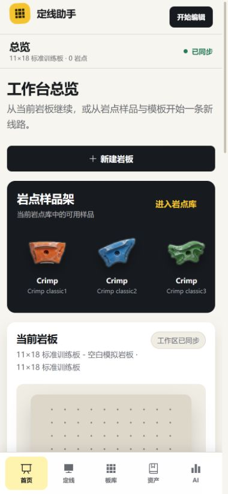
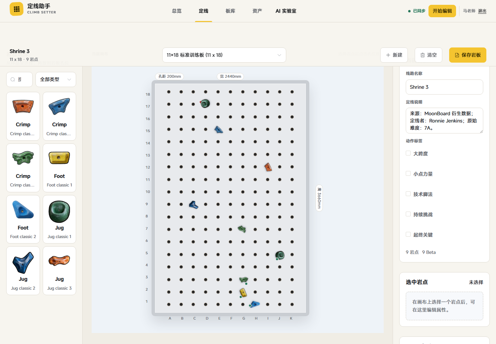
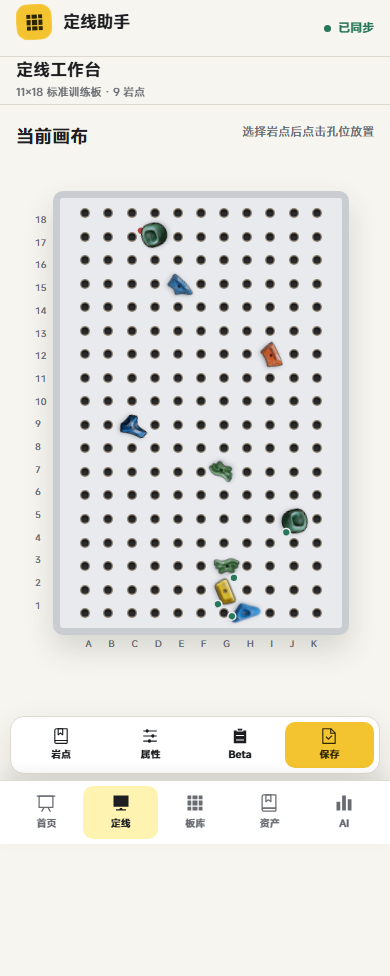
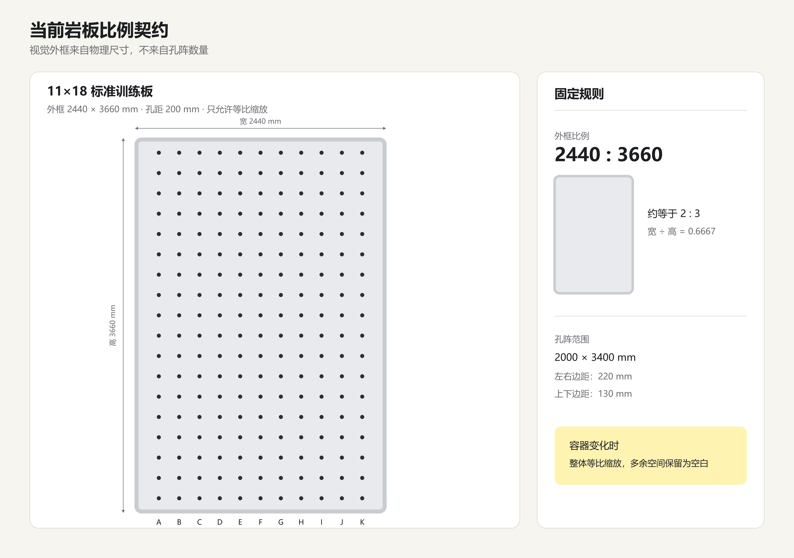

# 效果图索引

这些图片是视觉层级、密度、比例和响应式关系的参考。它们不替代业务数据合同，也不要求逐像素复制临时内容。

| 文件 | 角色 | 重点参考 |
|---|---|---|
| [01-dashboard-desktop.png](./effects/01-dashboard-desktop.png) | 总览桌面基准 | 64px 横向顶栏、暖白环境、岩点样品架、60/40 主辅区、稀缺香蕉黄 |
| [02-dashboard-596.png](./effects/02-dashboard-596.png) | 窄桌面/平板总览 | 内容纵向重排、样品横滑、固定底部导航与卡片密度 |
| [03-dashboard-mobile.png](./effects/03-dashboard-mobile.png) | 移动总览基准 | 56px 品牌栏、48px 上下文、五入口底栏、单列阅读顺序 |
| [04-studio-desktop.png](./effects/04-studio-desktop.png) | 定线桌面基准 | 样品区—技术画布—检查器三栏结构，画布视觉中心 |
| [05-studio-596.png](./effects/05-studio-596.png) | 窄屏定线基准 | 画布保护、工具坞与移动壳体切换方式 |
| [06-studio-mobile.png](./effects/06-studio-mobile.png) | 移动定线基准 | 画布优先、四项工具坞、五入口底栏、触控密度 |
| [07-board-ratio-contract.png](./effects/07-board-ratio-contract.png) | 岩板几何合同 | `2440:3660` 外框比例、`11×18` 孔阵、边距与等比缩放 |

## 快速预览

### 总览桌面

### 总览移动端

### 定线桌面

### 定线移动端

### 岩板物理比例

## 参考边界

- `01–06` 主要用于确认视觉语言和响应式骨架；页面内的具体数字、线路名称和资产数量可以随真实数据变化。
- `07` 是几何硬合同，不是概念建议。所有岩板画布、缩略图和预览都必须遵循。
- 定线编辑器截图中的操作反馈只属于编辑状态，不得套用到标准板库只读线路预览。
- 本包没有收入旧版标准板库截图，因为其满板背景岩点与彩色荧光标点已经被最新决策废弃。新的标准板库截图只有在“默认隐藏非线路岩点、没有额外标点”后才能补入。

## 明确排除的旧方向

- `docs/screenshots/` 下蓝色侧栏管理后台截图。
- `.impeccable/review/standard-1440.png` 中已经废弃的满板岩点和荧光标点表达。
- `.impeccable/mocks/dashboard-specimen-shelf.png` 中的木质墙面与外部概念资产；其样品架想法已经由本包的真实生产截图替代。
- 任何把岩板孔阵 `11×18` 当作画布长宽比的历史图。

## 新图进入标准包的条件

1. 同时提供桌面与移动视口，至少覆盖 `1440×1000` 和 `390×844`。
2. 岩板使用 `2440:3660` 物理比例并能说明坐标来源。
3. 使用项目真实岩点和本地 MiSans，不请求外部素材或字体。
4. 不包含木纹、渐变、玻璃、Emoji、蓝色侧栏或页面级横向溢出。
5. 标准板库图必须展示正确的“显示其他岩点”逻辑，且没有额外荧光标点。
