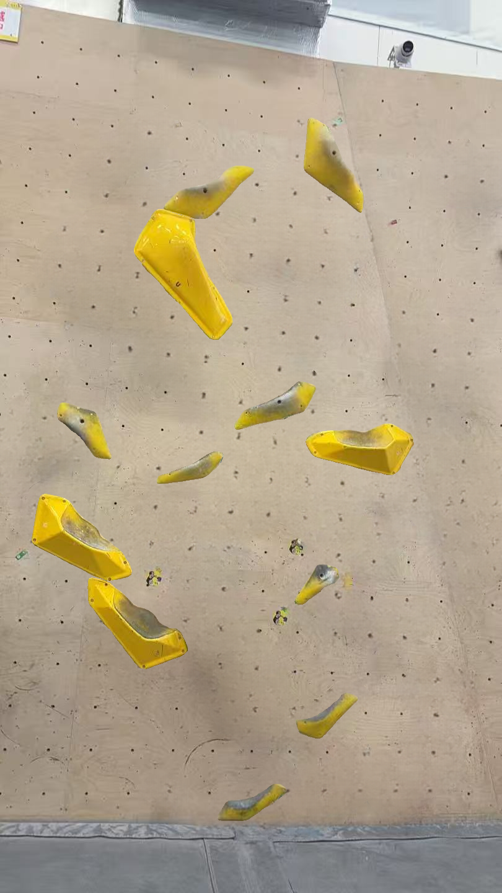
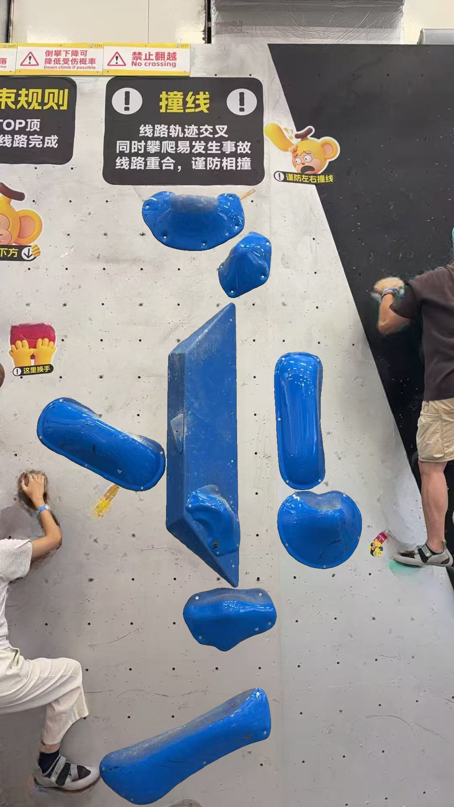

# 照片线路背景净化：补充需求与本地原型

版本：V1.1 补充，2026-09-03。用户新增要求：提取目标线路后，附带原墙面，去除其他线路，留下背景墙和目标线路。

## 新增展示模式

在“原图对照”和“纯色背景复刻”之外，增加“净化墙面＋目标线路”。保留原墙面的视角、整体颜色、已知纹理和未修补区域，去除未选线路的岩点及造型，并修补被移除物体和阴影占据的区域。

这是对 V1.0“照片仅作对照”的明确扩展；纯色模式仍保留。原照片不覆盖，修补结果作为独立衍生素材保存。当前按安全默认值只清理其他线路的岩点及造型，人物、标牌保留；是否一并去掉已向用户询问，尚待回复。

## 分层与可编辑性

- 输出独立墙面底图，以及保留原始像素的目标线路对象层。不能把目标线路烙印在背景中，否则对象移动会留下旧位置残影。
- 生成底图时也修补目标对象原位置，再将目标对象抠图叠回；目标对象的颜色、纹理、位置、比例与已确认轮廓不由修补模型改写。
- 背景与目标线路使用同一照片裁剪/旋转/校正变换和画布比例坐标。沿用自由布局，不转换为网格孔位或毫米。
- 修补只改变明确选区及其阴影边缘。需要保留的人物等区域可设保护蒙版。原图、目标蒙版及已有保存版本保持不变。
- 同一原图的多条线路各有独立净化背景和修补版本，不因修改一条而改变其他线路。

## 清理流程与真实性

目标线路确认后 → 提出墙面其他对象候选 → 预览“保留/移除”范围并补选或擦除 → 在本机/项目服务器生成净化墙面 → 对照检查后应用背景。

分割结果只能提出候选，不自动证明线路归属。允许补画漏检小点、扩大阴影区域和保护前景人物。将来页面应沿用手机/电脑均可用的缩放、画笔、撤销/重做；后台任务提供进度、取消、失败和重试，未确认不能假报“清理完成”。

岩点背后的真实墙面在原图中不可见。填补部分是视觉修补，可能合成孔位、接缝和纹理，不作为真实墙面测量或孔位数据。修补蒙版随素材保存，可随时对照原图。此项允许修补墙面，不放宽目标岩点/造型的遮挡补全限制。

所有推理仍在本机或项目服务器运行。可提前下载公开模型到本地；运行缺少模型时明确失败，不自动外传照片或改用在线服务。

## 未来数据接入

照片线路增加背景模式、净化背景素材引用、修补/保护蒙版、来源变换、背景任务及结果版本、算法与本地模型版本。背景任务结果须绑定原图哈希与已确认的对象选区；选区改变后旧背景标为待更新，不能静默覆盖新的线路编辑。保存继续沿用编辑权、版本检查及跨设备草稿机制。

新增验收：其他线路没有明显残留；目标对象不被误擦或重绘；墙面没有明显色块、重复岩点或严重修补接缝；对象移动不残留旧位置的目标图像；背景模式切换、保存重开、同图多线隔离一致。目标数量指标不能替代背景质量验收。

## 本次已执行的原型

已新增隔离的全景候选扫描、显式复核蒙版、背景修补和分层合成代码。使用已有本地 MobileSAM 扫描，再用本地 LaMa 修补；没有接入生产页面或业务接口。

| 样本 | 黄色 | 蓝色 |
|---|---:|---:|
| 保留目标对象 | 12（排除旧误选贴纸） | 10 |
| 助手选择的移除候选 | 33 | 20 |
| 额外手工补画区域 | 2 个漏检灰点 | 2 个灰点、1 个被人物部分遮住的绿点 |
| 全景候选扫描完整耗时 | 102.985 秒 | 105.922 秒 |
| 复核后修补与合成完整耗时 | 10.953 秒 | 10.969 秒 |
| 修补进程峰值内存统计 | 1382.6 MiB | 1390.5 MiB |
| 目标区域像素被改动 | 0 | 0 |
| 修补蒙版外像素被改动 | 0 | 0 |

上述耗时每组一次，在 Windows 本机 CPU 两线程运行；扫描和修补分进程顺序进行，均有 180 秒硬截止。人工复核时间不计入其中，也不包含之前提取目标线路的耗时，不能当成一键自动清理全流程耗时。正式服务器尚未验证。

目前清理选择由助手目视复核并显式补画，不是全自动识别成功，也不冒充用户验收。42 项相关测试通过，新增覆盖目标像素保护、背景与前景分离、人物保护、错误输入、缺失模型、结果形状与复核来源绑定。

### 当前实验图

黄色多数其他岩点已移除，但大面积修补区仍可见纹理变化；蓝色人物接触处、鞋边和局部墙面仍有修补痕迹/少量颜色残留，不能宣称已通过“干净背景”验收。原来的蓝色造型/大岩点轮廓问题也没有由背景修补解决。原型结果状态保持 `needs_visual_review`。

完整证据在工作区 `photo-route-evidence/wall-yellow-v1`、`photo-route-evidence/wall-blue-v1`，保存候选目录、显式复核 JSON、每个蒙版、修补底图、目标叠加图和性能日志。文档证据目录保存当前结果及关键复核材料。

## 本地模型来源

[LaMa 原项目](https://github.com/advimman/lama)；本次使用 [simple-lama-inpainting 的公开 TorchScript 模型](https://github.com/enesmsahin/simple-lama-inpainting/releases/tag/v0.1.0)，按其[模型加载代码](https://github.com/enesmsahin/simple-lama-inpainting/blob/main/simple_lama_inpainting/models/model.py)采用本地 CPU 推理。未安装或调用它的在线演示。

本机权重：`D:/ai_climbing_code/photo-route-experiments/lama/big-lama.pt`，SHA-256：`7ba7aa7ac37a4d41fdbbeba3a2af7ead18058552997e3a3cd1a3b2210c9e6b4c`。模型不纳入业务仓库或原服务器验证包。本次没有新增生产依赖、数据库操作、推送或部署。
