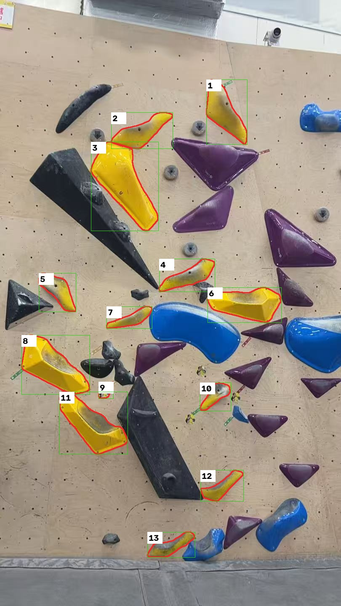
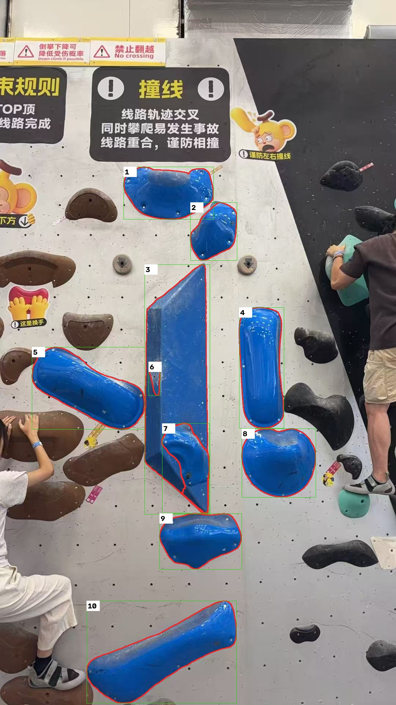

# 照片线路识别可行性验证报告

> 接续入口：本篇保留 v1–v5 历史实验。2026-09-03 后续 v6、完整耗时/内存、硬超时及服务器验证包见[续接验证记录](照片线路识别续接验证记录.md)。总门槛仍未通过。

日期：2026-09-03。状态：**前置门槛未通过，完整照片线路功能尚未实现或部署。**

## 结论

两种方法均已在本机实际运行：现有依赖可支持的颜色与 GrabCut 基线，以及 CPU 上运行的 MobileSAM 分割。后者明显改善对象拆分和镁粉覆盖区域，但目前不能按需求宣告验收通过：

1. 黄色线路误选从两张贴纸减少为一张，按暂定对象清单计算，精确率从 85.71% 提升至 92.31%。对象数量指标达到 90% 目标，不代表轮廓与完整流程已经验收。
2. 用户已确认中部灰蓝色小岩点属于蓝线，第二张按十个对象核对。最新算法已独立提取该小点；蓝色造型与下部大岩点的可见轮廓分界仍不准确，大岩点带入部分三角形底座。
3. 用户确认的是灰蓝小点的归属及十个对象的清单范围，尚未确认逐像素轮廓；下表为助手目视复核的诊断数据，**不是人工验收通过记录，也不是分割 IoU**。
4. 只能报告本机耗时，不能外推服务器耗时。现有受限服务器运维通道没有运行新模型/基准的动作；未改动权限或绕开这一限制。

遵照需求第五节“先识别验证，再接入完整编辑流程”，本轮保留可复现实验、测试与结果，不把未过门槛的算法接入生产界面，不擅自降低指标或改用外部识别服务。

## 测量结果

| 方法 | 第一张黄色 | 第二张蓝色 | 观察 |
|---|---:|---:|---|
| OpenCV 基线 v1 | 11 个候选 / 0.781 秒 | 4 个候选 / 2.203 秒 | 大量同色粘连，镁粉边缘缺失；候选数不能当正确对象数 |
| OpenCV 改进 v2 | 10 个候选 / 0.828 秒 | 5 个候选 / 2.312 秒 | 缩小闭运算并拆开不相连区域，仍不能区分同色相接对象 |
| MobileSAM v1 | 13 个候选 / 22.718 秒 | 8 个候选 / 18.907 秒 | 有重复、异色碎片及父子蒙版重叠 |
| MobileSAM v2 | 14 个候选 / 14.015 秒 | 9 个候选 / 19.500 秒 | 加入区域拆分、去重及嵌套可见区域分离；仍有贴纸和轮廓问题 |
| MobileSAM v3 | 未运行 | 14 个候选 / 58.328 秒 | 大对象局部放大找到灰蓝小点，但裁剪边缘产生错误碎片；未采用该结果作为当前结果 |
| MobileSAM v4 | 14 个候选 / 14.281 秒 | 10 个候选 / 63.391 秒 | 排除裁剪边缘残片，灰蓝小点独立提取；大岩点边界仍不准确 |
| MobileSAM v5（当前） | 13 个候选 / 14.656 秒 | 10 个候选 / 91.812 秒 | 每个拆分后区域重新检查颜色，移除一张贴纸；数量达到目标，轮廓和服务器性能仍待验收 |

计时为每次独立进程的提取函数耗时（含该函数内模型加载），不含上传、图片解码与证据文件编码；每组仅测一次，未测 P95 或多用户负载。各版本单次速度差异不能当成稳定加速或变慢结论。

| 最新 v5 暂定核对 | 黄色 | 蓝色 |
|---|---:|---:|
| 参考对象数 | 12 | 10，灰蓝色小点归属已由用户确认 |
| 独立定位对应数 | 12 | 10 |
| 自动候选数 | 13 | 10 |
| 暂定召回率 | 100% | 100% |
| 暂定精确率 | 92.31% | 100%（只代表对象定位） |
| 另行记录的问题 | 9 号为贴纸 | 3、7 号轮廓分界异常；6 号为新检出的灰蓝小点 |
| 门槛通过 | 否 | 否 |

黄色误选与蓝色轮廓问题不会被候选计数掩盖。后续修改算法必须重新产生证据并重新核对，不能继续套用旧编号评审。v2 的结果与复核文件保留在 `photo-route-evidence/v2/`，当前目录为 v5 结果。

## 图像证据

绿色框用于定位，红线为实际蒙版轮廓，数字对应逐对象核对表。图像来自本地算法输出，未使用图像生成服务。

### 黄色线路：13 个候选中包含一张贴纸



[查看干净背景提取结果](photo-route-evidence/yellow-replica.jpg)

### 蓝色线路：对象数量不能证明轮廓正确



[查看干净背景提取结果](photo-route-evidence/blue-replica.jpg)

[查看独立提取的灰蓝小岩点](photo-route-evidence/blue-small-hold.png)。它不再作为底层造型的一部分保留。该对象的编号为 6，指实拍可见部分，不包含不可见纹理。

## 已交付的代码与文档

- `backend/core/photo_route_processing.py`：图片大小/像素/格式/方向检查、本地颜色候选、GrabCut 修正、蒙版、抠图、边界提示和检查点取消/超时。
- `backend/core/photo_route_mobilesam.py`：可选的本地 CPU 分割实验适配器；明确使用本地权重与 `weights_only=True`，分离不相连区域、去重与嵌套可见区域；局部放大大对象以发现低饱和度小岩点，排除裁剪截断候选，并按每个独立区域检查颜色纯度。
- `backend/scripts/benchmark_photo_routes.py`：输出原图哈希、点选坐标、参数、耗时、运行环境、对象蒙版、透明抠图、叠加图与复刻图。
- `backend/scripts/evaluate_photo_routes.py`：依据显式复核表计数；合并、重复、误选不能增加召回；标注未确认、轮廓严重错误或生产计时缺失时不能宣告过门槛。
- `docs/photo-route-evidence/`：最新实验报告、逐对象复核 JSON、计算指标和结果图。复核者明确标记为助手，`human_confirmed=false`。
- `docs/照片线路提取需求与实施状态.md`：完整确认需求、兼容性约束、后续接口与状态要求。

尚未实现：照片线路库、编辑页面、自动透视校正、后台识别任务 API、画笔修正、保存/归档接口、自动草稿和跨设备续编。现有生产功能没有接入实验模块。模型当前以每次函数调用加载，尚未做服务常驻、内存预算及硬超时的进程隔离；检查点取消不是生产任务硬终止保证。

## 运行环境与模型来源

- Windows / Python 3.12.13，AMD64 Family 25 Model 117 Stepping 2，16 个逻辑处理器。
- CPU 推理；MobileSAM 使用两个 PyTorch 工作线程，OpenCV 使用一个线程。未使用 GPU。
- PyTorch 2.8.0+cpu、torchvision 0.23.0+cpu、timm 0.9.16、OpenCV 5.0.0。
- [MobileSAM 官方仓库](https://github.com/ChaoningZhang/MobileSAM)，锁定代码提交 `f706ad9c4eb7f219c00d9050e46328518ffb65d2`。
- 官方仓库 `weights/mobile_sam.pt`，40,728,226 字节；SHA-256：`6dbb90523a35330fedd7f1d3dfc66f995213d81b29a5ca8108dbcdd4e37d6c2f`。
- 模型、权重和推理依赖下载在实验目录/隔离环境内，不属于生产依赖，不提交模型权重。推理没有发送照片到服务商，也没有调用在线演示。
- 当前机器模型代码位于 `D:/ai_climbing_code/photo-route-experiments/MobileSAM`，完整实验输出位于 `D:/ai_climbing_code/photo-route-evidence`。

## 复现方式

以下命令从项目 `backend` 目录执行。使用具有项目图像依赖的 Python 环境。MobileSAM 额外依赖可先从 PyTorch 官方 CPU 索引安装 `torch==2.8.0`、`torchvision==0.23.0`，再安装 `timm==0.9.16`；不要将整套实验依赖自动加入生产环境。

```powershell
# 原有图像处理方案
python scripts/benchmark_photo_routes.py --image 'D:/ai_climbing_code/抱石路线1.jpg' --seed 0.383 0.285 --output 'D:/ai_climbing_code/photo-route-evidence/yellow-new-run'

# 预先安装本地代码与权重后执行，参数不包含逐对象标注
python scripts/benchmark_photo_routes.py --image 'D:/ai_climbing_code/抱石路线1.jpg' --seed 0.383 0.285 --mobile-sam-repo 'D:/ai_climbing_code/photo-route-experiments/MobileSAM' --checkpoint 'D:/ai_climbing_code/photo-route-experiments/MobileSAM/weights/mobile_sam.pt' --output 'D:/ai_climbing_code/photo-route-evidence/yellow-model-new-run'

# 第二张对应参数：照片为 抱石路线2.jpg，点选坐标 0.445 0.271。
# 根据已保存的本轮结果重新计算诊断指标
python scripts/evaluate_photo_routes.py --report ../docs/photo-route-evidence/yellow-report.json --review ../docs/photo-route-evidence/yellow-review.json --output ../docs/photo-route-evidence/yellow-metrics.json
python scripts/evaluate_photo_routes.py --report ../docs/photo-route-evidence/blue-report.json --review ../docs/photo-route-evidence/blue-review.json --output ../docs/photo-route-evidence/blue-metrics.json

# 自动测试
python -m unittest test_photo_route_processing test_hold_image_processing
```

原图哈希分别见 `yellow-report.json` 和 `blue-report.json`。参数、蒙版与轮廓均保留，能够复核本轮对象对应关系。新输出应使用新目录；算法调整后旧复核表不再自动有效。

## 验证与后续条件

- 新增 19 项测试及原有岩点录入 8 项测试，共 27 项通过。
- 覆盖：格式/体积/像素上限、EXIF、透明及动画输入、无效点击、红色色相跨界、镁粉内部保留、原图不变、蒙版去重、嵌套可见区域、取消/超时检查和计数门禁。
- 发现原有上传测试未隔离岩点元数据路径，补充两处临时路径隔离；测试产生的时间戳已精确恢复，业务数据无遗留修改。
- 本轮没有改动前端；没有部署、推送或数据库操作。尚未验证触屏修正耗时、用户正式标注与生产硬件性能。

下一步保持已确认范围和 90% 目标：灰蓝小点的线路归属已明确，无须再次询问。需要建立可见轮廓标注，并继续解决同色造型上大岩点的独立边界；服务器耗时与人工修正流程尚未测量。更换模型不等于需要更换服务器，不能依据本轮本机结果要求升级硬件。

如果选择优先交付更多依赖人工修正的交互原型，属于调整现有实施门槛，应由用户明确决定；本轮未自行采用此降级路线。
